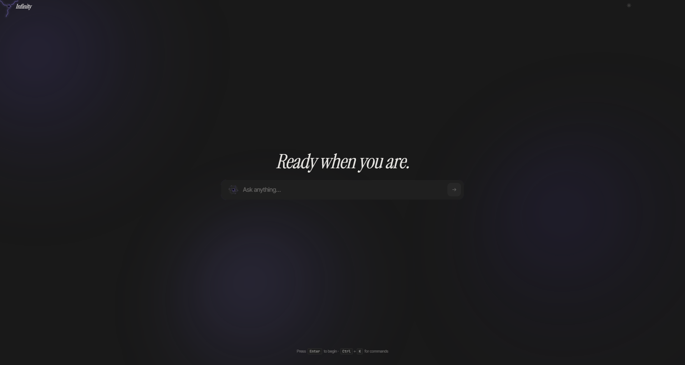

# Infinity

An AI workspace on one canvas. Chat with an assistant that can read your
documents, browse the web, take notes and write code, and that points back to
where its answers came from.



## What it does

- **Chat** with an assistant that uses tools, not just talk.
- **Vault.** Add PDFs, documents and web pages, then ask questions and get
  answers that cite the source.
- **Browse.** Fetch and read a page, then save it to the Vault.
- **Code.** A real editor with your own workspace of files.
- **Tiles.** Notes, tasks, a world clock, weather, markets, news, research and
  more, arranged however you like.
- **Skills.** Reusable instructions the assistant follows for recurring jobs.

## Two ways to run it

**As a public website.** Visitors open the page and start working. There is no
sign-up. Each browser tab gets its own private, throwaway session: nobody else
can see it, and everything in it is deleted when the tab closes. A notice at the
bottom of the screen says so, with a button to clear the session at once.

**For yourself.** One owner, protected by a password you set on first run. Your
notes, files and chats stay until you delete them.

Both can be installed as a desktop app from Chrome or Edge. Open the site, then
choose **Install** from the address bar or the browser menu.

## Run it yourself

You need an [OpenRouter](https://openrouter.ai) API key.

### Docker

```bash
git clone https://github.com/Anuj-Attri/infinity.git
cd infinity
docker build -f infra/Dockerfile -t infinity .
docker run -p 127.0.0.1:8000:8000 \
  -e ALLOW_PUBLIC=1 \
  -e OPENROUTER_API_KEY=sk-or-v1-your-key \
  -e DATA_DIR=/data -v infinity-data:/data \
  infinity
```

Open <http://localhost:8000> and set your password.

The `127.0.0.1:` prefix keeps the app reachable from your own computer only.
`ALLOW_PUBLIC=1` is needed because, seen from inside a container, your browser
is not "this machine". Drop the prefix only if you also set the access settings
below. The volume keeps your data across rebuilds.

### From source

Requires Python 3.12 and Node 22.

```bash
# backend
cd backend
python -m venv .venv && . .venv/bin/activate      # Windows: .venv\Scripts\activate
pip install -r requirements.txt
uvicorn app.main:app --port 8787

# frontend, in a second terminal
cd frontend && npm install && npm run dev
```

Open <http://localhost:5173>.

## Configure

Copy `.env.example` to `.env`. Every setting is explained there. The main ones:

| Setting | What it does |
|---|---|
| `OPENROUTER_API_KEY` | **Required.** Every model call. |
| `DATA_DIR` | Where data is written. Point it at storage you keep. |
| `VOYAGE_API_KEY` | Optional. Search your Vault and notes by meaning, not just exact words. |
| `SPEND_CAP_USD` | Optional. A monthly spending limit for model calls. Past it, the hosted model stops answering. |
| `LOCAL_MODEL_URL`, `LOCAL_MODEL` | Optional. A model on your own hardware, such as [Ollama](https://ollama.com), that answers when the hosted model can't. |

### When the model is unavailable

If the spending limit is reached, the OpenRouter key runs out of credit, or the
provider can't be reached, users see a plain "Model unavailable right now"
message. No billing details are shown.

If a local model is configured, it answers instead, and each such reply is
labelled as coming from the local model. For Ollama:

```bash
ollama pull llama3.2
LOCAL_MODEL_URL=http://localhost:11434/v1 LOCAL_MODEL=llama3.2
```

Any server with an OpenAI-compatible chat API works, including LM Studio and
llama.cpp.

### Put your own instance online

- Set `ACCESS_TOKEN`. Without it, nothing but your own machine gets in.
- Set `SETUP_TOKEN`, so a stranger cannot claim the instance during first-run setup.
- Set `ALLOWED_ORIGINS` to your real address. Never `*`.

### Run it as a public website

Set `GUEST_SESSIONS=1`. Visitors then get throwaway sessions instead of a
sign-in, as described above. Sessions are deleted when the tab closes. A browser
does not always report a close, so any session idle for `GUEST_IDLE_MINUTES`
(30 by default) is deleted too, and a restart deletes any that are left.

Guests cannot change keys, connectors, skills or spend settings for the
instance. They do spend your model credit, so set `SPEND_CAP_USD` and put a
hard credit limit on your OpenRouter key before you share the link.

### Deploy it for free

[](https://render.com/deploy?repo=https://github.com/Anuj-Attri/infinity)

The repo includes a [Render](https://render.com) Blueprint (`render.yaml`) that
runs it as a public guest-mode site on Render's free plan.

1. Click the button above, or in the Render dashboard choose **New, Blueprint**
   and pick this repo.
2. Paste an OpenRouter key when asked. Give that key its own credit limit,
   because visitors spend it.
3. Click **Apply**. The first build takes a few minutes.

After that, every push to `main` that passes CI deploys automatically. A free
service sleeps after 15 minutes without visitors and takes about a minute to
wake. Its disk is wiped on every restart, which suits guest mode.

With a paid Hugging Face plan, `scripts/deploy_hf_space.py` deploys to a Docker
Space instead, also runnable from the **Deploy** workflow in GitHub Actions.

## Your data

Everything is stored in your instance, under `DATA_DIR`. It leaves only when
the assistant sends your request to the model provider you configured. API
keys are read from the environment, never written to the repository, and
stripped from error reports.

In guest mode, a session's data is removed from the server when the session
ends, and nothing is kept in the visitor's browser after the tab closes.

## Licence

MIT. Use it, change it, ship it, sell it. Keep the copyright notice in copies.
Copyright (c) 2026 Anuj Attri. See [LICENSE](LICENSE).
